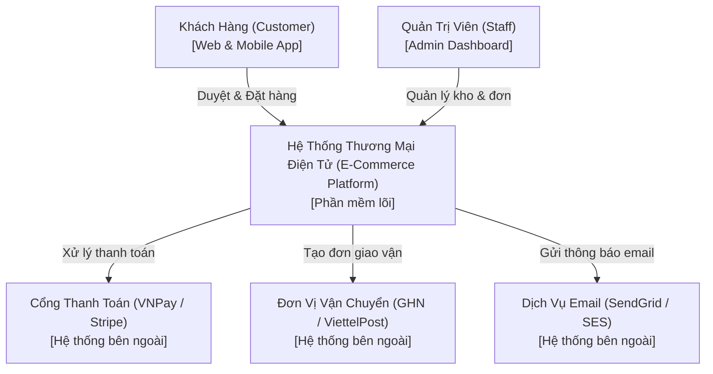
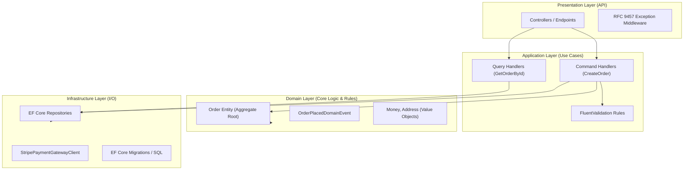
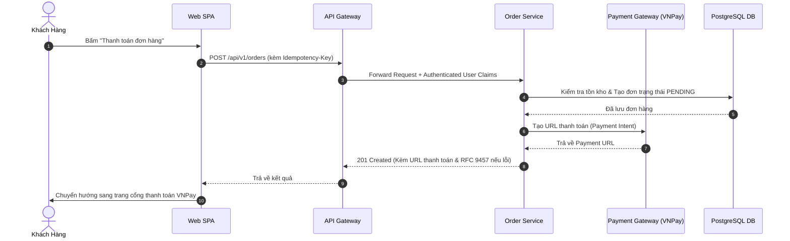
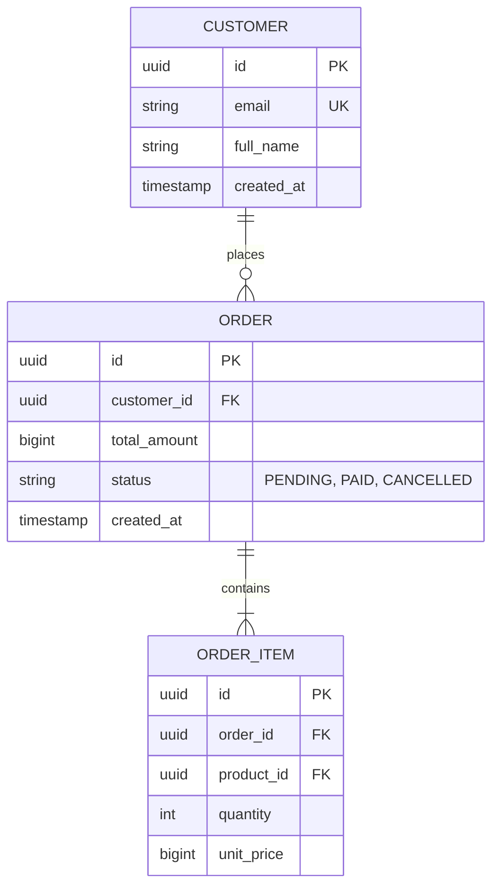

# Quy Chuẩn Tài Liệu Cấu Trúc Hệ Thống (System Structure & Architecture Documentation)

Tài liệu cấu trúc hệ thống (Architecture Overview / System Structure Document) cung cấp bức tranh toàn cảnh (Bird's-eye View) về cách các thành phần phần mềm, phần cứng, cơ sở dữ liệu và các hệ thống bên ngoài tương tác với nhau.

Tài liệu cấu trúc phải được viết bằng định dạng **Markdown**, tích hợp sơ đồ đồ họa trực tiếp qua **Mermaid** và liên kết chặt chẽ với các bản ghi quyết định kiến trúc (**MADR**).

---

## 1. Mô Hình C4 Trong Tài Liệu Kiến Trúc (The C4 Model)

Tài liệu cấu trúc hệ thống Enterprise được tổ chức theo 4 cấp độ trực quan hóa của **C4 Model**:

```text
Cấp độ 1: Bối Cảnh Hệ Thống (System Context) -> Dành cho ban giám đốc, đối tác, BA
Cấp độ 2: Các Vùng Chứa (Containers)         -> Dành cho kỹ sư hệ thống, DevOps, Tech Lead
Cấp độ 3: Các Thành Phần (Components)        -> Dành cho lập trình viên phát triển service
Cấp độ 4: Mã Nguồn & Lớp (Code / Classes)    -> Tùy chọn, dành cho thuật toán phức tạp
```

---

## 2. Bản Mẫu Chi Tiết Từng Cấp Độ C4 (Kèm Mermaid)

### Cấp Độ 1: Sơ Đồ Bối Cảnh Hệ Thống (System Context)
Mô tả người dùng và các hệ thống bên ngoài (External Systems) tương tác với giải pháp của bạn:



---

### Cấp Độ 2: Sơ Đồ Khối Ứng Dụng (Container Diagram)
Mô tả các ứng dụng, microservices, kho lưu trữ dữ liệu và cách chúng giao tiếp với nhau (HTTP/REST, gRPC, Message Queue):

```mermaid
flowchart TD
    subgraph ClientLayer ["Tầng Khách Hàng (Clients)"]
        WebSpa["Single Page App (React)<br>[TypeScript, Tailwind]"]
        MobileApp["Mobile App (Flutter)<br>[iOS & Android]"]
    end

    subgraph GatewayLayer ["Tầng Cổng & Bảo Mật"]
        ApiGateway["API Gateway / Reverse Proxy<br>[YARP / Nginx, OIDC JWT Auth]"]
    end

    subgraph ServicesLayer ["Tầng Dịch Vụ Nghiệp Vụ (Microservices)"]
        AuthSvc["Auth Service<br>[ASP.NET Core]"]
        OrderSvc["Order Service<br>[ASP.NET Core / Clean Arch]"]
        PaymentSvc["Payment Service<br>[Go / Worker]"]
    end

    subgraph DataLayer ["Tầng Lưu Trữ & Hàng Đợi (Data & Messaging)"]
        Postgres[(PostgreSQL Cluster<br>[ACID Primary-Replica])]
        RedisCache[(Redis Cluster<br>[Distributed Cache & Lock])]
        RabbitMQ([RabbitMQ / Kafka<br>[Event Bus]])
    end

    WebSpa -->|HTTPS / REST| ApiGateway
    MobileApp -->|HTTPS / REST| ApiGateway

    ApiGateway -->|Auth Valid| AuthSvc
    ApiGateway -->|Orders API| OrderSvc
    ApiGateway -->|Payments API| PaymentSvc

    OrderSvc -->|Read/Write| Postgres
    OrderSvc -->|Cache & Idempotency| RedisCache
    OrderSvc -->|Publish OrderPlaced| RabbitMQ
    RabbitMQ -->|Consume Event| PaymentSvc
```

> **Liên kết ADR**:
> * Xem quyết định lựa chọn PostgreSQL thay vì MongoDB tại: [`ADR-0001`](../decisions/0001-use-postgresql-for-relational-data.md).
> * Xem quyết định sử dụng RabbitMQ làm Event Bus tại: [`ADR-0003`](../decisions/0003-use-rabbitmq-for-async-events.md).

---

### Cấp Độ 3: Kiến Trúc Thành Phần Bên Trong Một Service (Component Diagram)
Áp dụng mô hình **Clean Architecture / Hexagonal Architecture** với nguyên tắc phụ thuộc đảo ngược (Dependency Inversion Principle):



---

## 3. Sơ Đồ Quy Trình Tuần Tự (Sequence Diagram Cho Luồng Nghiệp Vụ)

Mọi luồng nghiệp vụ phức tạp liên quan đến nhiều bên (Multi-party Interaction) bắt buộc phải có sơ đồ tuần tự:



---

## 4. Sơ Đồ Thực Thể Cơ Sở Dữ Liệu (ER Diagram)

Mọi cấu trúc bảng dữ liệu nghiệp vụ chính phải được đặc tả bằng Mermaid ERD:



---

## 5. Cấu Trúc Lưu Trữ Trong Kho Mã Nguồn

```text
my-project/
├── docs/
│   ├── architecture/
│   │   ├── system-context.md       # C4 Level 1 & 2
│   │   ├── component-design.md     # C4 Level 3
│   │   ├── data-models-erd.md      # Sơ đồ thực thể ERD
│   │   └── security-architecture.md
│   ├── api/
│   │   ├── api-standards.md        # Chuẩn RFC 9457 & REST conventions
│   │   └── endpoints/              # Chi tiết từng phân hệ API
│   └── decisions/                  # Toàn bộ file MADR 3.0 (0001, 0002...)
```

